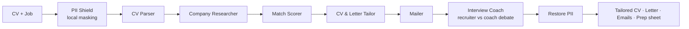

# 🧭 JobPilot

**A team of 7 AI agents that prepares a job application end to end, while your CV never leaves your machine unmasked.**

Paste a CV and a job posting. Get a match score, a tailored CV, a cover letter, application + follow-up emails, a company brief and an interview prep sheet.

## Why it's different
Your name, email, phone and links are **masked locally** (`[NAME_1]`, `[EMAIL_1]`...) before any text reaches an LLM, then restored in the final documents. Add Ollama and nothing leaves your computer at all.

## Architecture

Orchestrated with [LangGraph](https://github.com/langchain-ai/langgraph).

## Quick start
```bash
pip install -r requirements.txt
cp .env.example .env            # works out of the box in offline demo mode
python main.py --cv examples/sample_cv.txt --job examples/sample_job.txt --company Acme
streamlit run app.py            # web UI
docker compose up               # or Docker
```
Real mode: set `LLM_PROVIDER=openai` or `anthropic` and your key in `.env`.
**100% local:** `LLM_PROVIDER=openai`, `OPENAI_BASE_URL=http://localhost:11434/v1`, `LLM_MODEL=llama3.1` (Ollama).

## Honesty guardrails
The tailoring prompts forbid inventing experience, degrees or numbers. PII masking is regex-based (emails, phones, links, the name on the first line, plus names you pass in); review outputs before sending, and don't treat it as a compliance guarantee.

## Benchmark
```bash
python benchmark.py --cv examples/sample_cv.txt   # add more postings in examples/jobs/
```
Run it with your model and paste your numbers here: `N postings · avg match score · avg time`.

## Tests
`pytest`

## Roadmap
PDF export · LinkedIn job URL import · multilingual letters · better NER-based masking

## License
MIT
